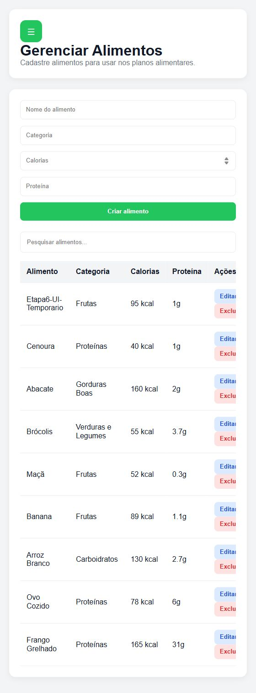
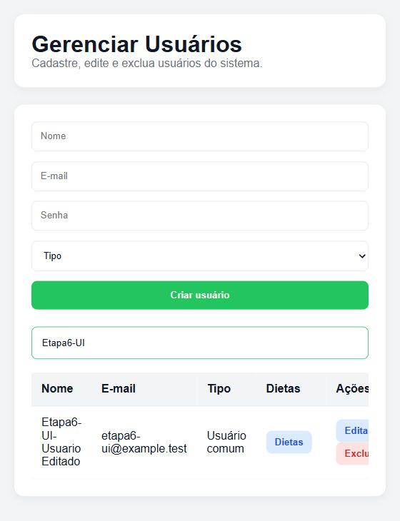
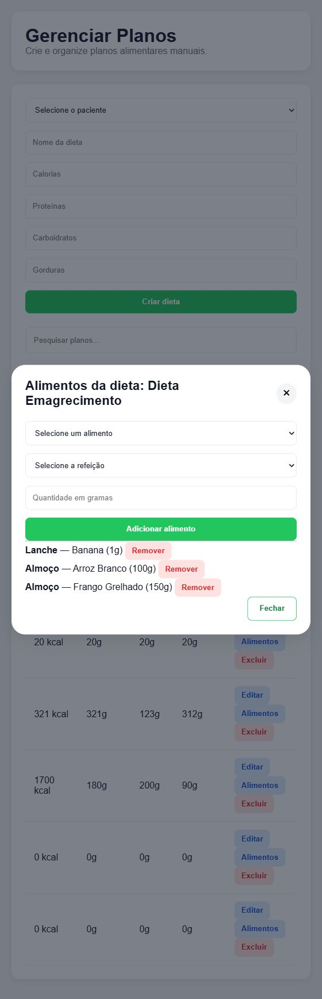
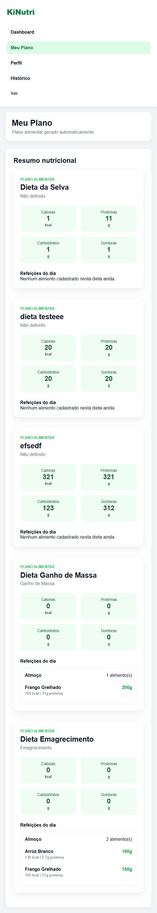

# Etapa 06 — implementação e evidências

Validação realizada em **08/10/2026**, com Apache/MySQL do XAMPP e a API local real.

## Requisitos e demonstração

| Requisito | Evidência no código |
| --- | --- |
| Entidades utilizadas | User, Food, Diet, UserProfile e DietFood em assets/js/common/classes |
| Encapsulamento e validação | Construtores, campos #, getters/setters, EntityValidation |
| Conversão JSON/API | fromJSON/toJSON; serviços convertem leituras; sessão devolve User |
| Herança | Os três serviços estendem HttpClientBase |
| Composição | Diet contém DietFood[]; Meu Plano preenche dieta.foods |
| HTTP centralizado | Fetch somente em HttpClientBase; JWT atualizado a cada requisição |
| Serviços integrados | Controllers com API, autenticação e exportação migrados |
| Três CRUDs | Usuários, dietas e alimentos, com persistência no MySQL |
| Dois protótipos | ToastPrototype e FormControllerPrototype, Object.create, métodos compartilhados |
| Toast | success/warning/error; respostas com/sem data/message; fallback seguro |
| Interface | Loading, sucesso, erro, vazio e bloqueio temporário de botões |

## Resultados automatizados

- **8 testes passaram:** entidades/composição; Toast; formulário; rotas/token; erros HTTP; exportação com entidades; refeições UTF-8; dependências dos HTML e ausência de HTTP direto nos controllers.
- **Integração real passou:** login, listagem/busca/criação/edição/exclusão de usuários, alimentos e dietas; leitura/gravação de perfil; planos por usuário; inclusão/consulta/remoção de alimentos da dieta.
- **Permissões passaram:** usuário comum recebe 403 nas novas operações administrativas; admin não pode excluir a própria conta; exclusão do usuário temporário mantém a dieta sem paciente.
- **Limpeza passou:** registros temporários removidos; contagens antes/depois iguais: **14 usuários, 8 planos, 8 alimentos**. Valores observados, não constantes no frontend.
- PHP validado com php -l, JavaScript com node --check; diff sem erros de whitespace.

## Navegador

Confirmados login administrativo e comum, logout, dashboards, listagens administrativas, criação/edição de alimento e usuário por formulário, modal de alimentos da dieta, Meu Plano com refeições, leitura/gravação de perfil, histórico de planos, alternância claro/escuro e notificações (criação e marcação como lidas). O tema inicial foi restaurado. Os registros temporários das verificações de formulário foram removidos pela API. Nas páginas inspecionadas, não houve erros/warnings no console após as correções.

A exportação foi validada por teste automatizado da integração do controller com o serviço e da serialização das entidades. A captura do download no navegador excedeu o tempo limite da ferramenta, portanto o arquivo baixado não foi inspecionado por esse caminho.

O teste automatizado da API cobre exclusões; registros preexistentes não foram excluídos pelas telas. Os botões utilizam modal de confirmação e os mesmos serviços validados.

### Alimento criado e atualizado

### Usuário criado e atualizado

### Vínculo entre dieta e alimentos

### Meu Plano

## Roteiro de apresentação

1. Abra Food.js: explique campos privados e o setter calories; mostre a rejeição de valor negativo.
2. Abra FoodService/HttpClientBase: explique extends, endpoint, transporte e JWT.
3. Abra alimentos.js: mostre serviço e DOM/eventos separados.
4. Abra Diet.js/meu-plano.js: demonstre a composição por DietFood[].
5. Abra os protótipos e execute os exemplos do README em uma página que os carregue; demonstre a igualdade dos métodos de duas instâncias.
6. Demonstre Toast com `{status: "success", message: "Salvo", data: {id: 1}}` e `{status: "warning", data: {}}`.
7. Demonstre os três CRUDs usando registros novos de demonstração, com Apache/MySQL ligados.
8. Execute os testes e mostre este relatório.

## Diferenças entre contexto e código real

Edição/exclusão de usuários não existiam e foram completadas com autorização expressa do usuário. A consulta individual GET de alimentos também estava ausente. O README antigo descrevia LocalStorage como banco e abertura direta do HTML; foi corrigido para PHP/MySQL. A exportação foi integrada aos serviços.

A leitura tolera e-mails legados; novos cadastros/edições validam o e-mail. O diretório de exemplos do professor não existe neste ambiente: os requisitos foram verificados contra o documento de contexto fornecido. Os arquivos originais poderão ser comparados se disponibilizados.
