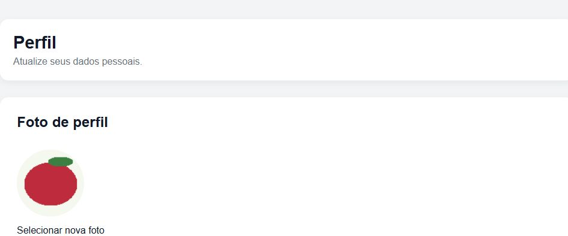
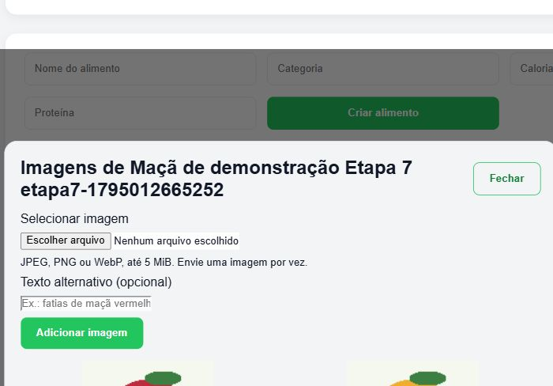

# Etapa 07 — validação e demonstração

Validação com Apache e MySQL do XAMPP e a API local do KiNutri.

- Na API, o teste enviou uma foto com um ID de terceiro no formulário e confirmou que apenas a conta do token mudou. Também confirmou a remoção da foto anterior, a leitura após novo login e a exclusão do arquivo ao remover a conta de teste.
- Um alimento temporário recebeu duas imagens independentes. O teste confirmou galeria vazia em outro alimento, bloqueio de alterações por usuário comum e bloqueio de remoção de imagem usando o ID do alimento errado.
- Arquivo falso com MIME declarado como PNG, arquivo acima de 5 MiB e texto alternativo longo foram rejeitados sem criar registros ou arquivos. Remover uma imagem preservou a outra; excluir o alimento removeu os metadados e o arquivo restante.
- Um gatilho temporário rejeitou a inserção de uma imagem de teste depois da gravação do arquivo. A API respondeu 500, o arquivo foi removido e a galeria continuou vazia. O gatilho e os dados de demonstração foram removidos após os testes.
- No navegador, selecionei uma imagem, conferi a prévia e enviei a foto. Em Alimentos, recarreguei a página, reabri a galeria e verifiquei que as duas imagens estavam renderizadas.





Para reproduzir, ligue o XAMPP, aplique a migração conforme o README e execute com Node.js 24:

```powershell
node --test tests/stage6.test.cjs
node tests/integration-stage6.cjs
node tests/integration-stage7.cjs
```

O teste usa a conta administrativa de demonstração do banco inicial. Para outra conta, defina `KINUTRI_TEST_EMAIL` e `KINUTRI_TEST_PASSWORD` no ambiente. Por padrão, ele remove os registros que cria. Para repetir a demonstração visual, execute `node tests/integration-stage7.cjs --demo`; para apagar os registros desse modo, execute `node tests/integration-stage7.cjs --clean-demo`.

Para apresentar em aula: mostre a foto com prévia em Perfil, adicione duas imagens ao mesmo alimento em Admin → Alimentos → Imagens, atualize a página e reabra a galeria. Remova uma imagem e confira que a outra continua aparecendo.
